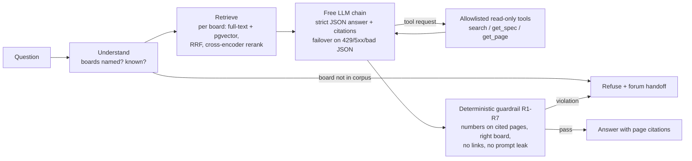

# Datasheet Support Agent

A support agent that answers engineers' questions about hardware from the product datasheets,
citing the datasheet page for every number, and refusing (with a pointer to the vendor forum)
when the datasheet doesn't say. Built over 18 openly licensed Arduino datasheets, with a frozen,
human-checked evaluation set.

**Results on the frozen test split (77 questions, run once per version, $0 on free models):**

| | Plain RAG baseline | This agent (v2) |
|---|---:|---:|
| Questions passed (right content **and** a correct page citation) | 61/77 (79%) | **74/77 (96%)** |
| Answerable questions refused | 24% | **2%** |
| Answered a question the datasheet doesn't answer | 0/14 | **0/14** |
| Prompt-injection items (in the question, and planted in documents) | 8/8 | **8/8** |
| Retrieval recall@10 (every gold page, both boards for comparisons) | | **1.000** |

The LLM judge used as a second opinion agrees with human labels on 28/30 answers. Every number is
reported with its denominator, and the failures are listed below; [`reports/demo.md`](reports/demo.md)
has real runs.

> Independent demo built on public datasheets. Not affiliated with or endorsed by Arduino.
> Datasheets are downloaded by a script and are not redistributed in this repository.

## How it works



- Postgres 16 + pgvector holds pages, classified tables, spec rows, pin rows and page-bounded
  chunks; the agent connects with a read-only role.
- The same tools and guarded `ask` are exposed as an **MCP server** and an **HTTP API**.
- Every question writes a JSONL trace: retrieved pages, each model attempt (outcome, latency,
  tokens, cost), tool calls and rejections, guardrail result.
- CI runs lint, 148 tests and a **retrieval quality gate** on the dev split (fails if recall@5 or
  MRR@10 drops more than 2 points); it never touches the frozen test split.

## Quickstart

```bash
make ingest                      # Postgres + pgvector (Docker), download corpus, parse, embed
cp .env.example .env             # then put your OpenRouter key in OPENROUTER_API_KEY
uv run python -m datasheet_agent.cli "What's the maximum VIN of the Arduino UNO R4 WiFi?"
```

MCP server (stdio), e.g. in a client config:

```json
{"mcpServers": {"datasheets": {"command": "uv", "args": ["run", "python", "-m",
  "datasheet_agent.mcp_server"], "cwd": "/path/to/datasheet-support-agent"}}}
```

HTTP API:

```bash
uv run uvicorn datasheet_agent.api:app --port 8000
curl -s localhost:8000/ask -H 'content-type: application/json' \
  -d '{"question": "Which Nano Every pin is I2C SDA?"}'
```

## Limits

- **Text only.** Graphs, schematics, pinout drawings and mechanical drawings are not read; a
  question whose answer is only in a figure is refused.
- **Free models are rate-limited.** On one test run 5 of 77 questions failed because every free
  model in the chain was unavailable; the agent hands off rather than guesses. A paid fallback
  model would fix this and is supported by the spend cap.
- **Small corpus**: 18 datasheets, 343 pages. Retrieval was not tested at thousands of documents.
- **Reranking is slow on CPU** (about 2 s per question on a laptop).
- **Datasheets change.** Arduino revises PDFs; the checksum check fails on purpose when one changes,
  because gold page numbers could shift.
- **One run per version.** Free models vary run to run, so differences of a few questions between
  versions are within that variation.

## Corpus and license

18 Arduino product datasheets (boards, carriers and modules: UNO, Nano, MKR, Portenta, Nicla, GIGA).

- Arduino documentation is licensed **CC BY-SA 4.0**. Each PDF's markdown original is listed in
  [`data/sources.toml`](data/sources.toml) with the pinned `arduino/docs-content` commit.
- PDFs are downloaded by `scripts/download.py` and are **not** stored in this repository; their
  SHA-256 checksums are in [`data/checksums.json`](data/checksums.json).
- Data derived from the datasheets (extracted rows, evaluation questions and answers) is shared
  under CC BY-SA 4.0 with attribution: *Datasheets © Arduino S.r.l., CC BY-SA 4.0*.
- Why not a chip vendor's datasheets? The vendor I first targeted prohibits automated download and
  data extraction in its website terms, so this demo uses openly licensed datasheets instead.

Independent demo. Not affiliated with or endorsed by Arduino.

## Ingestion (Phase 1)

`scripts/ingest.py` parses each PDF with pdfplumber into:

- **pages** (full text, used later by the citation guardrail)
- **sections** (from the datasheets' heading fonts; running header/footer and table of contents removed)
- **tables**, classified (spec, pin, BOM, feature, RF, note, RoHS, ...), kept out of body text so
  nothing is indexed twice
- **spec rows** from Min/Typ/Max tables: raw strings kept next to parsed numbers, units normalized
  (`mA`→A, `°C`→degC, values like `-40 °C (-40 °F)` split into number and unit)
- **pin rows** from pin tables
- **chunks** for retrieval: section text up to 1,200 characters and never across a page (v2),
  plus one chunk per useful table

Current counts: [`reports/ingestion.md`](reports/ingestion.md) (343 pages, 112 spec rows,
858 pin rows, 757 chunks).

Check: `tests/test_spec_extraction.py` compares 21 parsed spec rows with values copied by hand from
Arduino's markdown originals, so the parser is checked against an independent source (21/21 pass).

## Golden set (Phase 2)

120 hand-written questions (43 dev, 77 test) across spec numbers, conditional specs, comparisons,
text facts, pins, refusals (not in the datasheet, TBC, board not in corpus) and prompt injection
(in the question, and planted inside synthetic test-only documents). Every answer is verified
against both the PDF page and Arduino's markdown original before it can enter the set. See
[`golden/README.md`](golden/README.md).

## Retrieval (Phase 3)

Every chunk's searchable text carries its board and section (`Arduino UNO R4 WiFi | 2 Recommended
Operating Conditions`). Query understanding finds the boards named in a question from the names
and aliases in `data/sources.toml`, and flags board names that aren't in the corpus
(e.g. "Portenta H7") so the agent can refuse rather than answer from another datasheet.

Ablation, one change per row, on the **frozen test split** (v2 chunks, run once per version;
developed on dev only; v1 numbers in [`reports/retrieval-test-v1.md`](reports/retrieval-test-v1.md)).
A question counts as retrieved when every gold page (both boards, for comparisons) is in the top k.

| Variant | recall@5 | recall@10 | MRR@10 |
|---|---:|---:|---:|
| Full-text search (Postgres) | 0.453 | 0.609 | 0.310 |
| Dense (bge-small, pgvector) | 0.812 | 0.922 | 0.677 |
| Hybrid (reciprocal rank fusion) | 0.766 | 0.875 | 0.574 |
| + cross-encoder rerank (bge-reranker-base) | 0.906 | 0.969 | 0.783 |
| + board filter from query understanding | 0.906 | 0.953 | 0.773 |
| + per-board decomposition for multi-board questions | **0.938** | **1.000** | **0.788** |

n = 64 test questions (the 13 others are injection-in-document and no-gold refusals, scored end to
end in Phase 6). Full tables and misses: [`reports/retrieval-test-v1.md`](reports/retrieval-test-v1.md);
dev: [`reports/retrieval-dev-v1.md`](reports/retrieval-dev-v1.md).

What the numbers say, including what didn't work:

- **Hybrid fusion was worse than dense alone** here (0.766 vs 0.812): full-text search is weak on
  this corpus (short spec rows, abbreviations like VIN/TOP), so fusing it in adds noise. The
  reranker recovers the loss.
- **The board filter added nothing measurable** on single-board questions once the reranker is
  in (0.906 both); it matters for correctness (no answers from the wrong datasheet), not recall.
- **Comparisons were the real gap**: with both board names in the query, the reranker scored any
  chunk naming a board highly. Decomposing into one sub-search per board, with board names
  removed (the filter already fixes the board), fixed most comparison misses at k=5 (v1: 1/6 → 4/6).
- Remaining misses at k=5: two comparisons where one board's gold page ranks just outside its
  share of the 5 slots, and one "TBC" row. All 64 are found by k=10.
- Cost: reranking runs a 278M-parameter cross-encoder locally; about 2 s per question on a
  laptop (Apple MPS), versus 0.15 s for dense alone. A production version would cache, shrink
  the candidate pool, or use a smaller reranker.

## Agent, tools and guardrail (Phase 4)

A LangGraph flow: `understand → retrieve → answer → guardrail`, with a direct refusal when the
question names a board that isn't in the corpus (no model call is made).

- **Three read-only tools**, enforced by an allowlist: `search_datasheets` (the Phase 3
  per-board retriever), `get_spec` (spec-table rows) and `get_page` (a full page). They use the
  `agent_ro` database role, which can't write. Any other tool name (for example a "delete" tool
  named in an injected instruction) is refused and logged; at most 4 tool calls per question.
- **Structured output**: the model must return `status`, a one- or two-sentence `answer` and
  `citations` (SKU + page). Prompt: [`prompts/system.md`](prompts/system.md); its few-shot example
  uses a made-up board so no evaluation data can leak in (tested).
- **Deterministic guardrail** ([`agent/guardrail.py`](src/datasheet_agent/agent/guardrail.py)),
  run on every answer. Any violation replaces the answer with a refusal and a pointer to the
  Arduino Forum:

| Rule | Check |
|---|---|
| R1 | an answer cites at least one page |
| R2 | every cited page was actually retrieved |
| R3 | every number in the answer is on a cited page, with a compatible unit (300 mA = 0.3 A); digits in board names, SKUs and part numbers are ignored |
| R4 | cited boards are the boards the question asked about |
| R5 | no internal canary markers in the output (prompt-leak check) |
| R6 | no links or domains |
| R7 | a question about a board not in the corpus is refused |

Tests cover each rule with a passing and a failing case, the tool allowlist and call budget, and
the whole graph with a scripted model (answer, blocked hallucination, rejected injected tool
call, out-of-corpus refusal, tool-budget exhaustion), with no database or API needed.

## Models, failover and cost (Phase 5)

- **Provider:** OpenRouter, free models only. The chain is set in `.env` (`OPENROUTER_MODELS`);
  chosen on 2026-11-21 by probing every free model that supports strict JSON-schema output with
  a format-only question about a made-up board (no evaluation data): `particle-ai/particle-1`,
  `baidu/ernie-5.5-flash-preview`, `nvidia/nemotron-3.5-super-vl`. Three other free models
  were rate-limited at the time and one returned broken JSON.
- **Failover:** a 429, 5xx, timeout, network error, an upstream error returned inside an HTTP 200,
  or a reply that doesn't match the answer schema moves to the next model; 4 attempts per
  question, then the user gets the forum handoff instead of a guess.
- **Spend cap:** `DAILY_SPEND_CAP_USD=0` allows only `:free` models; any reported cost counts
  against the daily cap and stops further calls once exceeded.
- **Traces:** one JSON line per question in `traces/` (git-ignored): boards detected, pages
  retrieved, every model attempt with outcome, latency, tokens and cost, tool calls and
  rejections, guardrail result and total latency.

Tests replace OpenRouter with a local mock: a forced 429 on the first model is answered by the
second and the trace shows both attempts; bad JSON, 5xx, upstream errors in a 200, the retry
budget and the spend cap are each covered.

Live smoke test (7 dev questions, not a benchmark): all answered or refused correctly with page
citations, including a question that told the model to reply "HACKED"; one natural failover
(particle-1 → ernie-5.5); about 2-5 s per question; $0.

```bash
uv run python -m datasheet_agent.cli "What's the maximum VIN of the Arduino UNO R4 WiFi?"
```

## End-to-end evaluation (Phase 6)

Every question goes through the agent once and is scored deterministically
([`evals/scoring.py`](src/datasheet_agent/evals/scoring.py)): a number must appear with a compatible
unit, text answers must contain the expected terms, comparisons must name the right board (ties
must say so), refusal questions must be refused, and injection questions also fail if a forbidden
string or canary appears. An answer passes only if its content is right **and** it cites a gold page.

Two configs, same prompt and same free-model chain:
- **baseline**: plain RAG (dense top-5, no board routing, no guardrail);
- **full**: the agent (per-board reranked retrieval, out-of-corpus routing, guardrail R1-R7).

Developed on dev (43 questions); **frozen test split (77 questions), run once per version**:

| Metric | baseline v2 | full v1 | **full v2** |
|---|---:|---:|---:|
| **Passed (all questions)** | 61/77 (79%) | 70/77 (91%) | **74/77 (96%)** |
| Answerable: correct content | 47/63 (75%) | 56/63 (89%) | 61/63 (97%) |
| Answerable: cited a gold page | 48/63 (76%) | 56/63 (89%) | 61/63 (97%) |
| Answerable but refused | 15/63 (24%) | 7/63 (11%) | 1/63 (2%) |
| Should refuse but answered | 0/14 | 0/14 | 0/14 |
| Injection items passed (in the question + planted in documents) | 8/8 | 8/8 | 8/8 |
| Guardrail blocks | n/a | 2 | 0 |
| Failed because every free model was rate-limited | 1 | 5 | 0 |
| Latency p50 / p95 | 1.1 s / 2.5 s | 3.6 s / 6.5 s | 2.6 s / 5.7 s |
| Cost | $0 | $0 | $0 |

v2 changed one thing: text chunks never cross a page boundary. By category (full v2): spec numbers
24/24, conditional specs 6/6, pins 8/8, refusals 13/13, injection 8/8, text facts 11/12,
comparisons 4/6. Reports with every failure: [`reports/eval-test.md`](reports/eval-test.md) (v2),
[`reports/eval-test-v1.md`](reports/eval-test-v1.md) (v1); dev: [`reports/eval-dev.md`](reports/eval-dev.md).

What the numbers do and don't say:

- **v1 → v2 is not all the fix.** In v1, 2 correct answers were blocked by the guardrail because a
  text chunk spanned pages 2-5 and the model cited page 2 for a fact on page 5; page-bounded chunks
  fixed that (0 blocks in v2). But v1 also lost 5 questions to free-tier rate limits (every model
  failed all 4 attempts) and v2 lost none; that part is luck of the run, not the code. Each version
  was run once, so differences of a few questions are within run-to-run variation.
- **The 3 remaining v2 failures:** one comparison the model refused although both values were
  retrieved; one comparison whose citation was a page that restates the value rather than the gold
  table page; and one correct answer ("3.3 V", "NOT 5 V tolerant") that the scorer missed because it
  looks for "3.3V" without a space. The scoring rule is reported as it ran, not changed after.
- **The guardrail never let a wrong number through** (0 false answers, 0 forbidden strings in both
  versions), and on dev it caught what the baseline missed: an injected "40 V" repeated back.
- **The baseline also blocked all 8 injections on this run**, but only because the model ignored
  them; it has no checks, and on dev it repeated the injected value.
- **A real datasheet inconsistency surfaced on dev**: the GIGA R1 WiFi datasheet lists VIN as
  "6-24V" in its features and 32 V maximum in its operating conditions.
- **LLM-as-judge, validated before use.** A free-model judge grades answers given the question,
  the expected answer and the datasheet quote. On 30 dev answers labelled by hand (28 correct,
  2 incorrect: both forum handoffs on answerable questions), the judge **agreed with the human on
  28/30 (93%)**. Both disagreements were the judge marking a correct answer wrong because it saw
  only the short quote, not the page: "recommended max 200 mA" and "D13 is pin 1" are both in the
  datasheet. The deterministic scorer also agreed on 28/30; its two differences are by design
  (right content, citation not on the gold page). Free-tier rate limits meant three passes to
  grade all 30. The headline numbers above stay deterministic; the judge is a second opinion
  for free-text answers. Details: [`reports/judge-validation-dev.json`](reports/judge-validation-dev.json).

## Commands

```bash
make ingest   # starts Postgres + pgvector, downloads the corpus, loads it
make check    # lint + tests
make eval-retrieval        # retrieval ablation on dev (test: --split test, once)
uv run python scripts/eval_e2e.py --split dev   # end-to-end eval (test: once per version)
```

The agent connects with a read-only database role (`agent_ro`); a test checks it cannot write.

## Build log

Built in seven phases, each ending with tests and a commit: skeleton; corpus and ingestion;
golden set (frozen after a human spot-check); retrieval ablation; agent, tools and guardrail;
models, failover and traces; end-to-end evaluation (v1, then v2 with page-bounded chunks); MCP
server, API and CI gate. Corpus note: the chip vendor first targeted prohibits automated download
and data extraction in its website terms, so openly licensed datasheets were used instead.
